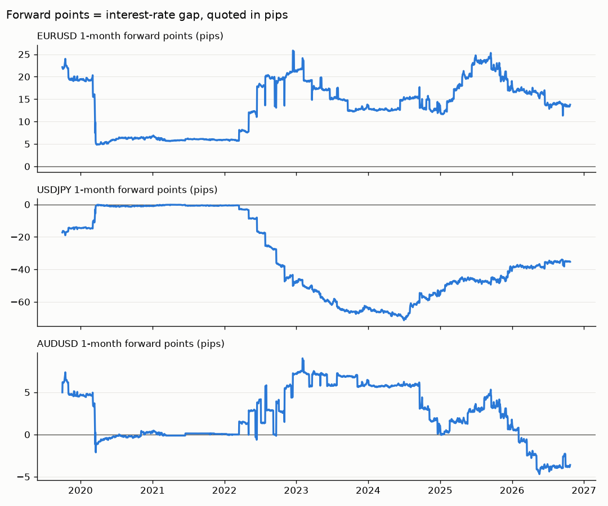
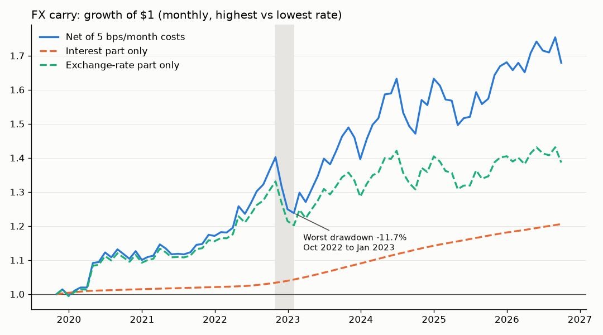

# fx-carry

A small Python project that tests a simple FX carry trade on daily data for USD, EUR, JPY and AUD from October 2019 to September 2026. At each month-end it buys the currency with the highest overnight interest rate against the one with the lowest, using a 1-month forward. It then splits every month's return into the interest earned and the exchange-rate move, and charges a trading cost. Forwards are priced from spot and the two interest rates (covered interest parity), and that pricer is tested against hand-worked examples. Plain-English notes on each step are in [docs/NOTES.md](docs/NOTES.md).

## Question and answer

**Does FX carry earn money after costs, and what does a crash look like?**

- **After costs, yes, in this sample:** **7.78% a year** (compounded) with a cost of 5 bps per monthly roll. Sharpe is **0.84** and the **worst drawdown is −11.7%** (end-Oct 2022 to end-Jan 2023, long USD / short JPY).
- **Costs matter little here.** With no costs the return is 8.42% a year; at 10 bps it's 7.14%.
- **What a crash looks like:** small, steady interest gains, then sudden exchange-rate losses that wipe out months of carry. The worst single month was July 2024 (−6.1%), the start of the yen carry unwind. That month's exchange-rate loss was worth more than a year of interest.

**Most of the profit came from exchange-rate moves, not interest.** At 5 bps, the monthly parts sum to: interest **+20.6%**, exchange rate **+38.6%**, costs **−4.2%**. The dollar happened to rally against the euro and the yen while the strategy was long dollars. That's luck in this sample, not something carry reliably delivers.

## Charts

**1-month forward points.** The forward price differs from spot by the interest-rate gap between the two currencies, quoted in pips.



**Equity curve, net of 5 bps per month.** The worst drawdown is shaded. The dashed "interest part" and "exchange-rate part" lines are **simple running sums of monthly returns, not compounded**, so they don't multiply out to the blue equity line.



## Install and run

Requires Python 3.13. On Windows:

```
python -m venv .venv
.venv\Scripts\python -m pip install -r requirements.txt

.venv\Scripts\python data.py       # clean daily table -> data/clean_daily.csv
.venv\Scripts\python forward.py    # forward points -> charts/forward_points.png
.venv\Scripts\python backtest.py   # backtest summary, equity curve -> charts/equity_curve.png
.venv\Scripts\python -m pytest     # tests (offline)
```

On macOS or Linux, use `.venv/bin/python` instead. The data is in the repo (`data/raw/fx_carry_sample.csv`), so after installing, nothing needs the internet.

| File | What it does |
|---|---|
| `data.py` | Cleans the raw CSV: three FX pairs plus one overnight rate per currency |
| `forward.py` | Forward pricer and forward-points chart |
| `backtest.py` | Monthly carry backtest, return split, costs, drawdown, equity chart |
| `tests/` | Hand-worked tests for the forward price and the return math |

## Limitations

- **One pair at a time.** The strategy holds only the single highest- vs lowest-yielding currency, so results depend heavily on that one pair.
- **Four currencies.** USD, EUR, JPY and AUD only. Real carry strategies spread across many more.
- **Seven years.** Oct 2019 to Sep 2026 is 83 monthly returns, which is a short sample with one big dollar trend in it.
- **41 months in one position.** Long USD / short JPY was held from Sep 2022 to Feb 2026, about half the sample. The result is largely a bet on that one trade.
- **Month-end data hides crashes within a month.** For example, USD/JPY fell from 150.38 to 143.95 between Jul 31 and Aug 5, 2024, then partly recovered. Month-end prices don't show that.
- **Simple costs and pricing.** Costs are one flat number per month. Forwards are priced from overnight rates rather than market forward quotes.
